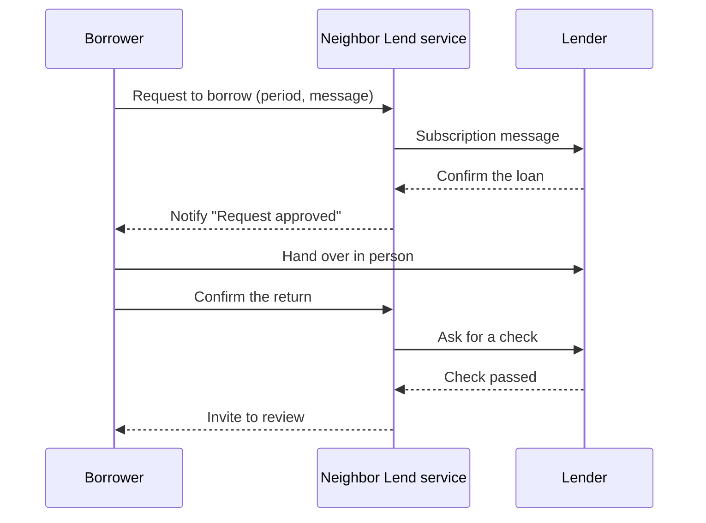
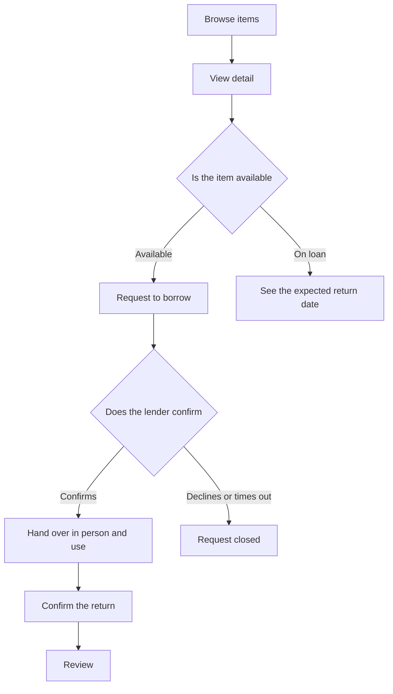

# Neighbor Lend PRD V1.0

> **Product**: Neighbor Lend　**Platform**: WeChat mini program
> **Version**: V1.0　**Document version**: v0.3　**Last updated**: 2026-10-28
> **Product manager**: (fictional example)　**Status**: In review
>
> This document is a **completely fictional** example for prd-generator. It is used for regression tests and as a writing reference and does not correspond to any real project.

**Revision Notes**

| Round | Date | Main changes | Edited by |
|---|---|---|---|
| Initial draft | 2026-10-20 | First version | Example |
| Review round 1 | 2026-10-27 | Added a "Confirm return" second-confirmation popup to the return flow to avoid mis-taps; chapter 3.2 now has a "Write a review" entry | Example |

---

## 1. Project Background

### 1.1 Background

Residents own many things they rarely use (power drills, tents, projectors) — on average fewer than 3 times a year — yet they take up space. When a neighbour suddenly needs one, the only options are to buy it or to "shout" in the owners' chat group, which is inefficient and awkward to repeat.

Today's group-chat requests get buried by other messages, lenders cannot tell whether the borrower is reliable, and borrowed items are forgotten. We want a lightweight mini program that structures "who has what and who needs what" and makes borrowing and returning traceable and reviewable.

The first release covers physical items inside a single community only; deposits, payments and cross-community loans are out of scope.

### 1.2 Target Users

| Dimension | Description |
|---|---|
| User group | Residents of the same community, mainly home owners aged 28-45 with families |
| Typical scenario | Before a renovation, a camping trip or an event, needing something for 1-3 days |
| Core need | To be able to borrow with confidence, and to get lent items back on time |

### 1.3 Core Goals

| Goal | Key metric | Target |
|---|---|---|
| Loan conversion | Rate of "request → lender confirms" | ≥ 60% |
| Fulfilment | On-time return rate (including confirmed returns) | ≥ 95% |
| Activity | Monthly active borrowers per community within 8 weeks of launch | ≥ 80 |

**North-star metric**: at least 150 successful loans per community per month.

---

## 2. Product Overview and Business Model

### 2.1 Product Positioning

"Neighbor Lend" is an item-lending mini program for the residents of a single community: people with idle items can lend them out easily, people with a short-term need can quickly find what their neighbours own, and confirmed returns plus mutual reviews keep everyone accountable.

### 2.2 Core Business Flow

### 2.3 Feature Architecture

| Module | Priority | Sub-module / feature | Notes |
|---|:-:|---|---|
| Discover and request | P0 | Item list → Search | Shown by community; keyword search supported |
| | P0 | Item detail → Request to borrow | Pick a loan period and leave a message |
| Return and review | P0 | My loans → Confirm return | The borrower confirms, the lender checks |
| | P1 | Review | Stars + tags; affects the neighbor credit score |

---

## 3. Functional Specifications

### 3.0 Reading Guide and Overall Page Flow

Organised in the order a user goes through the product: **find something to borrow, request it, then return it and leave a review**. Each chapter starts with its page-relationship diagram and page list, followed by page-by-page specifications. The diagram below only shows the main pages; states and exceptions are covered in the chapters.

---

### 3.1 Discover and request a loan

**Chapter page overview**: the user opens the mini program and sees the items of their community; they can browse or search. If nothing matches they see an empty state and can clear the search in one tap. From the item detail they tap "Request to borrow", choose a period and write a message in the popup, and send it; afterwards the detail page shows "Waiting for the lender".

**Page list**:

| Page / Popup | Section | Type | Entry | Exit |
|---|---|---|---|---|
| Item list | 3.1.3.1 | Page | Enter home; No search results: Clear search | No keyword match→No search results; Tap an item card→Item detail |
| No search results | 3.1.3.2 | Page state | Item list: No keyword match | Clear search→Item list |
| Item detail | 3.1.3.3 | Page | Item list: Tap an item card | Tap "Request to borrow"→Request popup |
| Request popup | 3.1.3.4 | Popup | Item detail: Tap "Request to borrow" | Send request→Request sent |
| Request sent | 3.1.3.5 | Page state | Request popup: Send request | — (end) |

#### 3.1.1 Feature Description

**As a** resident with a short-term need, **I want** to find borrowable items in my community quickly and send a request, **So that** I do not have to buy a new one or keep asking in the group chat.

**Scope**: browsing, searching, viewing details and sending a loan request. Item publishing, deposits and payments are not included. Lender-side confirmation, declining and checking will be described in a later "lender side" release; BR-04 and BR-05 are system rules executed automatically by the back end in this version and have no page of their own.

#### 3.1.2 Business Rules

| ID | Rule | Boundary conditions / notes |
|---|---|---|
| BR-01 | The item list only shows items in the borrower's own community whose status is "Available" or "On loan" | "On loan" items can be browsed but cannot be requested |
| BR-02 | A single loan can only be 1 / 3 / 7 days and must not exceed the lender's maximum loan period | If the lender allows at most 3 days, the "7 days" option is hidden |
| BR-03 | A borrower can have at most 1 active request per item | "Pending" and "On loan" both count as active |
| BR-04 | If the lender does not respond within 24 hours, the request closes automatically and the borrower is notified | After closing, a new request can be sent |

#### 3.1.3 Page Interaction

##### 3.1.3.1 Page Interaction — Item list

**Flow**: Enter home; No search results: Clear search; Review done: Back to Discover → **This page** → No keyword match: goes to "No search results"; Tap an item card: goes to "Item detail"; Bottom tab "My loans": goes to "My loans"

**Prototype**: `prototype/pages/list.html`

| Element | Type | Description |
|---|---|---|
| Community switch | Text button | Shows the current community; display only in the first release, switching is not supported |
| Search box | Input | Tap "Search" on the right to submit; does nothing when empty |
| Item card | List item | Thumbnail, name, lender's building and nickname, distance, status tag |
| Status tag | Tag | Green "Available"; orange "On loan · returns on date" |

**Interaction rules**:

1. Tapping an "Available" or "On loan" card opens the item detail; on an on-loan item the "Request to borrow" button is greyed out (see 3.1.3.3).
2. When the keyword matches nothing, the list is replaced by the empty state, see 3.1.3.2.
3. Items are sorted by distance, nearest first; equal distances are sorted by listing time, newest first.

##### 3.1.3.2 Page Interaction — No search results

**Flow**: Item list: No keyword match → **This page** → Clear search: returns to "Item list"

**Prototype**: `prototype/pages/list.html?s=empty`

| Element | Type | Description |
|---|---|---|
| Empty-state message | Text | "No '<keyword>' within 1 km", suggesting another keyword or a wider range |
| Clear search | Primary button | Clears the keyword and restores the full list |

**Interaction rules**:

1. The keyword stays in the search box so that it is easy to edit.
2. Tapping "Clear search" returns to the default list in 3.1.3.1.

##### 3.1.3.3 Page Interaction — Item detail

**Flow**: Item list: Tap an item card → **This page** → Tap "Request to borrow": opens "Request popup"

**Prototype**: `prototype/pages/detail.html`

| Element | Type | Description |
|---|---|---|
| Item photo | Image | A single image in the first release |
| Basic information | Info card | Lender (with a verified badge), distance, maximum loan period, deposit, current status |
| Request to borrow | Bottom primary button | Only tappable when the status is "Available"; greyed out with a reason otherwise |

**Interaction rules**:

1. Tapping "Request to borrow" opens 3.1.3.4.
2. If the current user already has an active request for this item (BR-03), the button reads "Waiting for the lender" and is greyed out, see 3.1.3.5.

##### 3.1.3.4 Page Interaction — Request popup

**Flow**: Item detail: Tap "Request to borrow" → **This page (popup)** → Send request: goes to "Request sent"; tap "Cancel" to close the popup

**Prototype**: `prototype/pages/detail.html` (a popup opens after entering the page)

| Element | Type | Description |
|---|---|---|
| Loan period | Single choice | 1 / 3 / 7 days, default 3 days; limited by BR-02 |
| Message | Input | Optional, up to 50 characters |
| Send request | Primary button | Closes the popup after submitting and notifies the lender |
| Cancel | Text button | Closes the popup; entered content is not kept |

**Interaction rules**:

1. After "Send request" is tapped the button shows a loading state; on success the popup closes and a toast "Request sent, waiting for the lender" appears.
2. If submitting fails (network error) the popup stays open and a toast says "Unstable network, please retry".

##### 3.1.3.5 Page Interaction — Request sent

**Flow**: Request popup: Send request → **This page (the "requested" state of the detail page)** → the lender confirms, or the request closes automatically after 24 hours

**Prototype**: `prototype/pages/detail.html?s=sent`

| Element | Type | Description |
|---|---|---|
| Status tag | Tag | Orange "Pending" |
| Request to borrow | Bottom button | The text changes to "Waiting for the lender" and the button is greyed out |

**Interaction rules**:

1. Once the lender confirms, the status becomes "On loan" and the borrower gets a subscription message; if the lender declines or the request times out (BR-04), the button becomes tappable again.

#### 3.1.4 Data Fields

| Field | Type | Required | Validation | Description | Example |
|---|---|:-:|---|---|---|
| item_id | String | Yes | Not empty | Item ID | I20261001 |
| duration_days | Enum | Yes | 1 / 3 / 7 and ≤ maximum loan period | Loan period | 3 |
| message | String | No | ≤ 50 characters, sensitive words filtered | Message | Saturday morning, for a bookshelf |

#### 3.1.5 Exception Handling

| Exception | Handling | User-facing message |
|---|---|---|
| Network error | Keep the popup, allow a retry | "Unstable network, please retry" |
| Item just borrowed by someone else | Close the popup, refresh the detail status | "Too slow — this item was just borrowed" |
| Search without results | Show the empty state | "No 'ladder' within 1 km" |

#### 3.1.6 Tracking Events

| Event ID | Event name | Trigger | Key parameters |
|---|---|---|---|
| EVT-01 | page_view | Enter the item list / detail | page_name |
| EVT-02 | click_search | Tap Search | keyword, result_count |
| EVT-03 | click_borrow | Tap "Request to borrow" | item_id |
| EVT-04 | submit_borrow | Tap "Send request" | item_id, duration_days, success |

---

### 3.2 Return and review

**Chapter page overview**: in "My loans" the borrower sees the active loans. After giving the item back they tap "I returned it", confirm in a popup, and arrive at the review page; for a completed loan they can also tap "Write a review" in the list directly. After submitting the review they see a completion page.

**Page list**:

| Page / Popup | Section | Type | Entry | Exit |
|---|---|---|---|---|
| My loans | 3.2.3.1 | Page | Tap bottom tab | Tap "I returned it"→Confirm-return popup; Tap "Write a review"→Review page |
| Confirm-return popup | 3.2.3.2 | Popup | My loans: Tap "I returned it" | Confirm return→Review page |
| Review page | 3.2.3.3 | Page | Confirm-return popup: Confirm return; My loans: Tap "Write a review" | Submit review→Review done |
| Review done | 3.2.3.4 | Page state | Review page: Submit review | Back to Discover→Item list |
| Item list | 3.1.3.1 | Page (other chapter) | Review done: Back to Discover | — (continues in Chapter 3.1) |

#### 3.2.1 Feature Description

**As a** borrower, **I want** to tell the lender with one tap that I have returned the item and leave a review, **So that** the lender feels at ease and my neighbor credit grows.

**Scope**: viewing loan records, confirming a return, reviewing. Late-return penalties are not included (later release).

#### 3.2.2 Business Rules

| ID | Rule | Boundary conditions / notes |
|---|---|---|
| BR-05 | After the borrower taps "Confirm return", the lender must check it before the loan counts as complete | If the lender does not check within 48 hours, the system treats it as passed |
| BR-06 | A review has 1-5 stars (required); tags and text are optional | A submitted review cannot be edited |
| BR-07 | For every completed and mutually reviewed loan, both sides get +2 neighbor credit | Only the first review counts |

#### 3.2.3 Page Interaction

##### 3.2.3.1 Page Interaction — My loans

**Flow**: Tap bottom tab; Item list: Bottom tab "My loans" → **This page** → Tap "I returned it": opens "Confirm-return popup"; Tap "Write a review": goes to "Review page"

**Prototype**: `prototype/pages/mine.html`

| Element | Type | Description |
|---|---|---|
| List group | Title | Only "Borrowed by me" in this release; "Lent by me" ships with the lender side |
| Loan card | List item | Item, lender, due time, status tag |
| I returned it | Pill button | Only shown for "On loan" orders |
| Write a review | Pill button | Only shown for "completed and not yet reviewed" orders |

**Interaction rules**:

1. Tapping "I returned it" opens 3.2.3.2 instead of submitting directly, to avoid mis-taps.
2. Tapping "Write a review" goes straight to 3.2.3.3.

##### 3.2.3.2 Page Interaction — Confirm-return popup

**Flow**: My loans: Tap "I returned it" → **This page (popup)** → Confirm return: goes to "Review page"; tap "Not returned yet" to close

**Prototype**: `prototype/pages/mine.html` (a popup opens after entering the page)

| Element | Type | Description |
|---|---|---|
| Message | Text | Explains that the lender will be asked to check after confirming |
| Confirm return | Primary button | After submitting, the order becomes "Waiting for the lender's check" |
| Not returned yet, tapped by mistake | Text button | Closes the popup |

**Interaction rules**:

1. After a successful submit the app opens the review page; if it fails, the popup stays and asks the user to retry.

##### 3.2.3.3 Page Interaction — Review page

**Flow**: Confirm-return popup: Confirm return; My loans: Tap "Write a review" → **This page** → Submit review: goes to "Review done"

**Prototype**: `prototype/pages/review.html`

| Element | Type | Description |
|---|---|---|
| Stars | Rating | 1-5 stars, default 5 |
| Review tags | Multi-select tags | Item works great / Pleasant communication / On-time handover / Item is worn |
| Comment | Input | Optional |
| Submit review | Primary button | A submitted review cannot be edited (BR-06) |

**Interaction rules**:

1. When "Item is worn" is selected, the comment becomes required and the user is asked to add details.

##### 3.2.3.4 Page Interaction — Review done

**Flow**: Review page: Submit review → **This page** → Back to Discover: returns to "Item list" (chapter 3.1)

**Prototype**: `prototype/pages/review.html?s=done`

| Element | Type | Description |
|---|---|---|
| Completion message | Text | Shows the total number of loans and the credit change (BR-07) |
| Back to Discover | Secondary button | Returns to the item list |

**Interaction rules**:

1. This page cannot go back to the review page; the system back key goes straight to "My loans".

#### 3.2.4 Data Fields

| Field | Type | Required | Validation | Description | Example |
|---|---|:-:|---|---|---|
| order_id | String | Yes | Not empty | Loan order ID | O20261015 |
| rating | Number | Yes | Integer 1-5 | Stars | 5 |
| tags | Array | No | Taken from the preset tags | Review tags | ["Pleasant communication"] |
| comment | String | No | ≤ 200 characters | Comment | The drill was well kept |

#### 3.2.5 Exception Handling

| Exception | Handling | User-facing message |
|---|---|---|
| Network error | Stay on the current page, allow a retry | "Unstable network, please retry" |
| Order already checked | Refresh the list status | "This loan is already complete; no need to confirm again" |
| Duplicate review | Block the submit | "You have already reviewed this loan" |

#### 3.2.6 Tracking Events

| Event ID | Event name | Trigger | Key parameters |
|---|---|---|---|
| EVT-05 | page_view | Enter My loans / the review page | page_name |
| EVT-06 | click_return | Tap "I returned it" | order_id |
| EVT-07 | confirm_return | Tap "Confirm return" | order_id, success |
| EVT-08 | submit_review | Tap "Submit review" | order_id, rating |

---

## 4. Non-functional Requirements

### 4.1 Performance

| Metric | Requirement |
|---|---|
| First-screen load | ≤ 2 s (4G network) |
| API response | P95 ≤ 500 ms |

### 4.2 Compatibility

| Platform / environment | Minimum version |
|---|---|
| WeChat | 8.0.30 |
| iOS / Android | iOS 14 / Android 10 |

### 4.3 Security and Privacy

- The lender's building is only shown down to the building number, never the door number.
- Messages are filtered for sensitive words; avatars and nicknames use WeChat-authorised information and no phone number is collected.

---

## 5. Appendix

### Appendix A: Glossary

| Term | Meaning |
|---|---|
| Lender | A resident who lists an item and agrees to lend it |
| Borrower | A resident who requests to borrow an item |
| Neighbor credit | +2 for every completed and mutually reviewed loan; shows how reliable someone is |

### Appendix B: Interactive Demo Pages

| Demo page | PRD section | Local file |
|---|---|---|
| Item list (incl. No search results) | 3.1.3.1 / 3.1.3.2 | `prototype/pages/list.html` |
| Item detail (incl. Request popup, Request sent) | 3.1.3.3 / 3.1.3.4 / 3.1.3.5 | `prototype/pages/detail.html` |
| My loans (incl. Confirm-return popup) | 3.2.3.1 / 3.2.3.2 | `prototype/pages/mine.html` |
| Review page (incl. Review done) | 3.2.3.3 / 3.2.3.4 | `prototype/pages/review.html` |

> In this version the online demo is not published. Use the `neighbor-lend-en-v1-0-prototype.zip` package delivered with this document: unzip it and open `index.html` in a browser; the screenshots in this document are the reference for page appearance.
