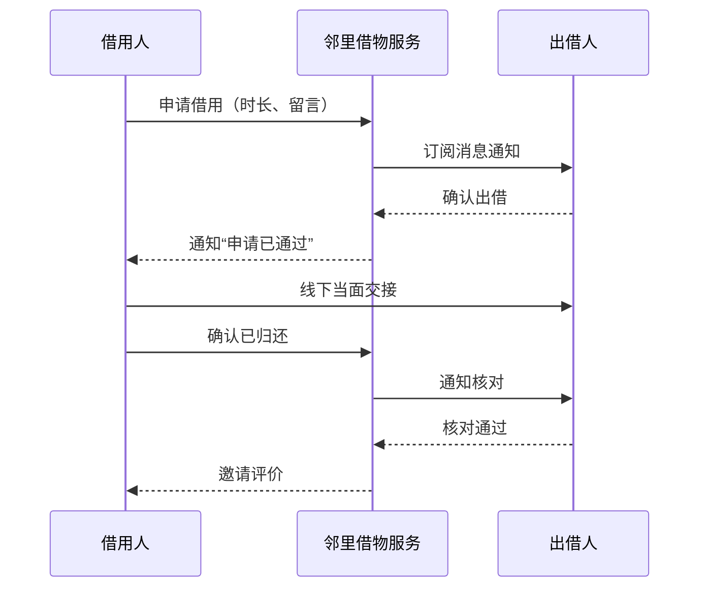
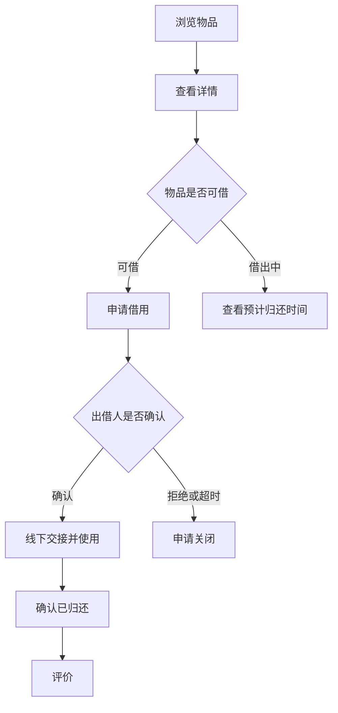

# 邻里借物 PRD V1.0

> **产品名称**：邻里借物　**所属平台**：微信小程序
> **版本**：V1.0　**文档版本**：v0.3　**最后更新**：2026-10-28
> **产品经理**：（虚构示例）　**状态**：需求评审中
>
> 本文档是 prd-generator 的**完全虚构**示例，用于回归测试与写作参照，不对应任何真实项目。

**修订说明**

| 轮次 | 日期 | 主要变更 | 修改人 |
|---|---|---|---|
| 初稿 | 2026-10-20 | 首次成稿 | 示例 |
| 评审一轮 | 2026-10-27 | 归还流程新增“确认归还”二次确认弹窗，避免误点；3.2 章补充“去评价”入口 | 示例 |

---

## 1. 项目背景

### 1.1 背景描述

小区居民家里有大量低频使用的物品（电钻、帐篷、投影仪），平均一年用不到 3 次，却占着空间；同时，邻居临时需要时往往只能花钱购买或在业主群里“喊一嗓子”，效率低、也不好意思反复开口。

业主群求借的现状是：消息被刷屏淹没、出借人不确定对方是否可靠、借出后忘记归还。我们希望用一个轻量的小程序，把“谁有什么、谁想借什么”结构化，并让借还过程可追踪、可评价。

首期只覆盖单个小区内的实物借用，不涉及押金、支付和跨小区。

### 1.2 目标用户

| 维度 | 描述 |
|---|---|
| 用户群体 | 同一小区的居民，以 28-45 岁有家庭的业主为主 |
| 典型场景 | 周末装修、露营、临时活动前，需要一件用 1-3 天的物品 |
| 核心诉求 | 借得到、借得放心；借出去的东西能按时拿回来 |

### 1.3 核心目标

| 目标维度 | 关键指标 | 目标值 |
|---|---|---|
| 借用成交 | 申请借用 → 出借人确认的转化率 | ≥ 60% |
| 履约 | 按期归还率（含确认归还） | ≥ 95% |
| 活跃 | 上线 8 周内单小区月活跃借用人数 | ≥ 80 人 |

**北极星指标**：单小区月成功借用次数 ≥ 150 次。

---

## 2. 产品概述与业务模式

### 2.1 产品定位

“邻里借物”是面向单个小区居民的物品借用小程序：让有闲置物品的人方便出借，让有临时需求的人快速找到邻居手里的东西，并用确认归还和互评保证履约。

### 2.2 核心业务流程

### 2.3 功能架构

| 一级模块 | 优先级 | 子模块 / 功能点 | 说明 |
|---|:-:|---|---|
| 发现与申请 | P0 | 物品列表 → 搜索 | 按小区范围展示，支持关键词搜索 |
| | P0 | 物品详情 → 申请借用 | 选择借用时长、留言 |
| 归还与评价 | P0 | 我的借用 → 确认归还 | 借用人确认，出借人核对 |
| | P1 | 评价 | 星级 + 标签，影响邻里信用分 |

---

## 3. 产品功能说明

### 3.0 阅读指引与整体页面流程图

按用户使用顺序组织：**先找到想借的东西，再申请借用，最后归还并评价**。每章开头先看本章的页面关系图和页面清单，再看逐页说明。下图只画主干页面，各种状态和异常去向在对应章节里。

---

### 3.1 发现与申请借用

**本章页面关系总览**：用户打开小程序先看到本小区的物品列表，可以直接浏览或搜索；搜不到时看到空态并可一键清除搜索条件回到列表。点进物品详情后点“申请借用”，在弹窗里选时长、写留言并发送，发送成功后详情页进入“等待出借人确认”状态。

**本章页面清单**：

| 页面/弹窗 | 章节 | 类型 | 进入方式 | 去向 |
|---|---|---|---|---|
| 物品列表 | 3.1.3.1 | 页面 | 进入首页；搜索无结果：清除搜索条件 | 关键词无匹配→搜索无结果；点击物品卡片→物品详情 |
| 搜索无结果 | 3.1.3.2 | 页面状态 | 物品列表：关键词无匹配 | 清除搜索条件→物品列表 |
| 物品详情 | 3.1.3.3 | 页面 | 物品列表：点击物品卡片 | 点“申请借用”→申请借用弹窗 |
| 申请借用弹窗 | 3.1.3.4 | 弹窗 | 物品详情：点“申请借用” | 发送申请→申请已发送 |
| 申请已发送 | 3.1.3.5 | 页面状态 | 申请借用弹窗：发送申请 | —（终点） |

#### 3.1.1 功能描述

**As a** 有临时需求的居民，**I want** 在小区范围内快速找到可借的物品并发出申请，**So that** 不用买新的，也不用在业主群里反复询问。

**范围**：浏览、搜索、查看详情、发起借用申请。不含物品发布、押金和支付。出借人侧的确认、拒绝和核对在后续“出借人端”版本中说明，BR-04、BR-05 属于系统规则，本版由后台自动执行，没有独立页面。

#### 3.1.2 业务规则

| 编号 | 规则描述 | 边界条件 / 说明 |
|---|---|---|
| BR-01 | 物品列表只展示借用人所在小区内、状态为“可借”或“借出中”的物品 | “借出中”的物品可浏览，但不可申请 |
| BR-02 | 单次借用时长只能选 1 / 3 / 7 天，且不得超过出借人设置的最长借期 | 出借人最长借期为 3 天时，不展示“7 天”选项 |
| BR-03 | 同一借用人对同一物品同时只能有 1 个进行中的申请 | 申请中 / 借用中均算进行中 |
| BR-04 | 出借人 24 小时内未响应，申请自动关闭并通知借用人 | 关闭后可重新申请 |

#### 3.1.3 页面交互说明

##### 3.1.3.1 页面交互说明 — 物品列表

**流转**：打开小程序，或从“评价完成”点“回到发现”回到本页 → **本页** → 点物品卡片到“物品详情”；关键词无匹配时进入“搜索无结果”状态；点底部 Tab“我的借用”进入“我的借用”

**关联原型**：`prototype/pages/list.html`

| 元素 | 类型 | 说明 |
|---|---|---|
| 小区切换 | 文字按钮 | 显示当前小区名；首期仅展示，不支持切换 |
| 搜索框 | 输入框 | 点击右侧“搜索”提交；为空时不触发 |
| 物品卡片 | 列表项 | 缩略图、名称、出借人楼栋与昵称、距离、状态标签 |
| 状态标签 | 标签 | 绿色“可借”；橙色“借出中 · 预计归还日期” |

**交互规则**：

1. 点击“可借”或“借出中”的卡片，均进入物品详情；借出中的详情页“申请借用”置灰（见 3.1.3.3）。
2. 关键词无匹配时，列表替换为空态，见 3.1.3.2。
3. 列表按距离由近到远排序，距离相同按上架时间倒序。

##### 3.1.3.2 页面交互说明 — 搜索无结果

**流转**：物品列表 关键词无匹配 → **本页** → 点“清除搜索条件”回到物品列表

**关联原型**：`prototype/pages/list.html?s=empty`

| 元素 | 类型 | 说明 |
|---|---|---|
| 空态提示 | 文案 | “附近 1 公里内没有「用户输入的关键词」”，并引导换词或扩大搜索范围 |
| 清除搜索条件 | 主按钮 | 清空关键词并恢复完整列表 |

**交互规则**：

1. 关键词原样回显在搜索框内，便于修改。
2. 点击“清除搜索条件”后回到 3.1.3.1 的默认列表。

##### 3.1.3.3 页面交互说明 — 物品详情

**流转**：物品列表 点物品卡片 → **本页** → 点“申请借用”弹出“申请借用弹窗”

**关联原型**：`prototype/pages/detail.html`

| 元素 | 类型 | 说明 |
|---|---|---|
| 物品主图 | 图片 | 首期单图 |
| 基本信息 | 信息卡 | 出借人（含实名标识）、距离、最长借期、押金、当前状态 |
| 申请借用 | 底部主按钮 | 仅状态为“可借”时可点；其他状态置灰并显示原因 |

**交互规则**：

1. 点击“申请借用”弹出 3.1.3.4。
2. 若当前用户已有该物品的进行中申请（BR-03），按钮显示“等待出借人确认”并置灰，见 3.1.3.5。

##### 3.1.3.4 页面交互说明 — 申请借用弹窗

**流转**：物品详情 点“申请借用” → **本页（弹窗）** → 点“发送申请”进入“申请已发送”状态；点“取消”关闭弹窗

**关联原型**：`prototype/pages/detail.html`（点击“申请借用”触发）

| 元素 | 类型 | 说明 |
|---|---|---|
| 借用时长 | 单选 | 1 / 3 / 7 天，默认 3 天；受 BR-02 限制 |
| 留言 | 输入框 | 选填，最多 50 字 |
| 发送申请 | 主按钮 | 提交后关闭弹窗并通知出借人 |
| 取消 | 文字按钮 | 关闭弹窗，不保留已填内容 |

**交互规则**：

1. 点击“发送申请”后按钮进入 loading，成功后关闭弹窗并显示 toast“申请已发送，等待出借人确认”。
2. 提交失败（网络异常）时弹窗保持打开，toast 提示“网络不稳定，请重试”。

##### 3.1.3.5 页面交互说明 — 申请已发送

**流转**：申请借用弹窗 发送申请 → **本页（详情页的已申请状态）** → 出借人确认或 24 小时后自动关闭

**关联原型**：`prototype/pages/detail.html?s=sent`

| 元素 | 类型 | 说明 |
|---|---|---|
| 状态标签 | 标签 | 橙色“申请中” |
| 申请借用 | 底部按钮 | 文案变为“等待出借人确认”，置灰 |

**交互规则**：

1. 出借人确认后，状态变为“借用中”，并向借用人发订阅消息；出借人拒绝或超时（BR-04），按钮恢复可点。

#### 3.1.4 数据字段说明

| 字段 | 类型 | 必填 | 校验规则 | 说明 | 示例 |
|---|---|:-:|---|---|---|
| item_id | String | 是 | 非空 | 物品 ID | I20261001 |
| duration_days | Enum | 是 | 1 / 3 / 7，且 ≤ 最长借期 | 借用时长 | 3 |
| message | String | 否 | ≤ 50 字，过滤敏感词 | 留言 | 周六上午装书架 |

#### 3.1.5 异常处理

| 异常场景 | 处理策略 | 用户提示文案 |
|---|---|---|
| 网络异常 | 保留弹窗，允许重试 | “网络不稳定，请重试” |
| 物品已被他人借走 | 弹窗关闭，刷新详情状态 | “手慢了，这件物品刚被借走” |
| 搜索无结果 | 展示空态 | “附近 1 公里内没有「梯子」” |

#### 3.1.6 埋点需求

| 事件 ID | 事件名 | 触发时机 | 关键参数 |
|---|---|---|---|
| EVT-01 | page_view | 进入物品列表 / 详情 | page_name |
| EVT-02 | click_search | 点击搜索 | keyword, result_count |
| EVT-03 | click_borrow | 点击“申请借用” | item_id |
| EVT-04 | submit_borrow | 点击“发送申请” | item_id, duration_days, success |

---

### 3.2 归还与评价

**本章页面关系总览**：借用人在“我的借用”里看到进行中的借用，物品还回后点“我已归还”，弹窗二次确认后进入评价页；也可以对已完成的订单在列表里直接点“去评价”。提交评价后看到完成页。

**本章页面清单**：

| 页面/弹窗 | 章节 | 类型 | 进入方式 | 去向 |
|---|---|---|---|---|
| 我的借用 | 3.2.3.1 | 页面 | 点底部 Tab | 点“我已归还”→确认归还弹窗；已完成订单点“去评价”→评价页 |
| 确认归还弹窗 | 3.2.3.2 | 弹窗 | 我的借用：点“我已归还” | 确认已归还→评价页 |
| 评价页 | 3.2.3.3 | 页面 | 确认归还弹窗：确认已归还；我的借用：已完成订单点“去评价” | 提交评价→评价完成 |
| 评价完成 | 3.2.3.4 | 页面状态 | 评价页：提交评价 | 回到发现→物品列表 |
| 物品列表 | 3.1.3.1 | 页面（他章） | 评价完成：回到发现 | —（终点） |

#### 3.2.1 功能描述

**As a** 借用人，**I want** 归还后一键告知出借人并留下评价，**So that** 出借人安心，我的邻里信用也能积累。

**范围**：借用记录查看、确认归还、评价。不含逾期罚则（后续版本）。

#### 3.2.2 业务规则

| 编号 | 规则描述 | 边界条件 / 说明 |
|---|---|---|
| BR-05 | 借用人点“确认已归还”后，需出借人核对通过，借用才算完成 | 出借人 48 小时未核对，系统自动视为通过 |
| BR-06 | 评价为 1-5 星，必选；标签与文字选填 | 评价提交后不可修改 |
| BR-07 | 每完成 1 次借用并互评，双方邻里信用分 +2 | 仅首次评价计分 |

#### 3.2.3 页面交互说明

##### 3.2.3.1 页面交互说明 — 我的借用

**流转**：物品列表 点底部 Tab“我的借用” → **本页** → 点“我已归还”弹出“确认归还弹窗”；已完成订单点“去评价”进入评价页

**关联原型**：`prototype/pages/mine.html`

| 元素 | 类型 | 说明 |
|---|---|---|
| 列表分组 | 标题 | 本版只有“我借入的”；“我借出的”随出借人端上线 |
| 借用卡片 | 列表项 | 物品、出借人、应还时间、状态标签 |
| 我已归还 | 胶囊按钮 | 仅“借用中”订单显示 |
| 去评价 | 胶囊按钮 | 仅“已完成且未评价”订单显示 |

**交互规则**：

1. 点击“我已归还”弹出 3.2.3.2，不直接提交，避免误点。
2. 点击“去评价”直接进入 3.2.3.3。

##### 3.2.3.2 页面交互说明 — 确认归还弹窗

**流转**：我的借用 点“我已归还” → **本页（弹窗）** → 点“确认已归还”进入评价页；点“还没还，点错了”关闭

**关联原型**：`prototype/pages/mine.html`（点击“我已归还”触发）

| 元素 | 类型 | 说明 |
|---|---|---|
| 提示文案 | 文字 | 说明确认后将通知出借人核对 |
| 确认已归还 | 主按钮 | 提交后订单进入“待核对” |
| 还没还，点错了 | 文字按钮 | 关闭弹窗 |

**交互规则**：

1. 提交成功后跳转评价页；提交失败停留在弹窗并提示重试。

##### 3.2.3.3 页面交互说明 — 评价页

**流转**：确认归还弹窗 / 我的借用“去评价” → **本页** → 点“提交评价”进入“评价完成”

**关联原型**：`prototype/pages/review.html`

| 元素 | 类型 | 说明 |
|---|---|---|
| 星级 | 评分 | 1-5 星，默认 5 星 |
| 评价标签 | 多选标签 | 物品很好用 / 沟通愉快 / 准时交接 / 物品有损耗 |
| 文字评价 | 输入框 | 选填 |
| 提交评价 | 主按钮 | 提交后不可修改（BR-06） |

**交互规则**：

1. 选择“物品有损耗”时，文字评价变为必填，提示补充说明。

##### 3.2.3.4 页面交互说明 — 评价完成

**流转**：评价页 点“提交评价” → **本页** → 点“回到发现”返回“物品列表”（3.1 章）

**关联原型**：`prototype/pages/review.html?s=done`

| 元素 | 类型 | 说明 |
|---|---|---|
| 完成提示 | 文案 | 显示累计借用次数与信用分变化（BR-07） |
| 回到发现 | 次按钮 | 返回物品列表 |

**交互规则**：

1. 本页不可返回评价页，系统返回键直接回到“我的借用”。

#### 3.2.4 数据字段说明

| 字段 | 类型 | 必填 | 校验规则 | 说明 | 示例 |
|---|---|:-:|---|---|---|
| order_id | String | 是 | 非空 | 借用订单 ID | O20261015 |
| rating | Number | 是 | 1-5 整数 | 星级 | 5 |
| tags | Array | 否 | 取自预设标签 | 评价标签 | ["沟通愉快"] |
| comment | String | 否 | ≤ 200 字 | 文字评价 | 物品保养得很好 |

#### 3.2.5 异常处理

| 异常场景 | 处理策略 | 用户提示文案 |
|---|---|---|
| 网络异常 | 停留当前页，允许重试 | “网络不稳定，请重试” |
| 订单已被核对完成 | 刷新列表状态 | “该借用已完成，无需重复确认” |
| 重复评价 | 阻止提交 | “你已评价过这次借用” |

#### 3.2.6 埋点需求

| 事件 ID | 事件名 | 触发时机 | 关键参数 |
|---|---|---|---|
| EVT-05 | page_view | 进入我的借用 / 评价页 | page_name |
| EVT-06 | click_return | 点击“我已归还” | order_id |
| EVT-07 | confirm_return | 点击“确认已归还” | order_id, success |
| EVT-08 | submit_review | 点击“提交评价” | order_id, rating |

---

## 4. 非功能需求

### 4.1 性能要求

| 指标 | 要求 |
|---|---|
| 首屏加载 | ≤ 2 秒（4G 网络） |
| 接口响应 | 95 分位 ≤ 500 ms |

### 4.2 兼容性要求

| 平台/环境 | 最低版本 |
|---|---|
| 微信 | 8.0.30 |
| iOS / Android | iOS 14 / Android 10 |

### 4.3 安全与隐私

- 出借人的楼栋仅展示到“栋”，不展示门牌号。
- 留言经敏感词过滤；用户头像与昵称使用微信授权信息，不额外收集手机号。

---

## 5. 附录

### 附录A：术语表

| 术语 | 说明 |
|---|---|
| 出借人 | 发布物品并同意借出的居民 |
| 借用人 | 申请借用物品的居民 |
| 邻里信用分 | 每完成并互评一次借用 +2，用于展示可靠程度 |

### 附录B：可交互 Demo 页面

| Demo 页面 | 对应 PRD 章节 | 本地文件 |
|---|---|---|
| 物品列表（含：搜索无结果） | 3.1.3.1 / 3.1.3.2 | `prototype/pages/list.html` |
| 物品详情（含：申请借用弹窗、申请已发送） | 3.1.3.3 / 3.1.3.4 / 3.1.3.5 | `prototype/pages/detail.html` |
| 我的借用（含：确认归还弹窗） | 3.2.3.1 / 3.2.3.2 | `prototype/pages/mine.html` |
| 评价页（含：评价完成） | 3.2.3.3 / 3.2.3.4 | `prototype/pages/review.html` |

> 本版未发布在线 Demo。请使用随交付包提供的 `neighbor-lend-v1-0-prototype.zip`，解压后打开 `prototype/index.html` 即可体验；各页面效果以文中截图为准。
