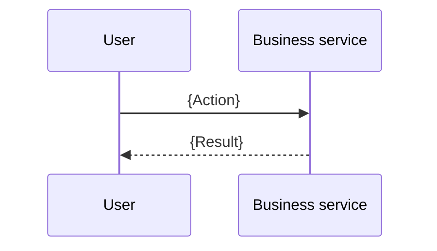

# {Product name} PRD {Version}

> **Product**: {Product name}　**Platform**: {Mini program / H5 / App / Admin system / API service}
> **Version**: {Version}　**Document version**: v{Doc version}　**Last updated**: {Date}
> **Product manager**: {PM}　**Status**: {Draft / In review / In development / Released}

**Revision Notes**

<!-- AI_INSTRUCTION: Write "Initial draft" for the first version; after each review round append one row stating what changed and why. For the review-revision mode see references/revision.md -->

| Round | Date | Main changes | Edited by |
|---|---|---|---|
| Initial draft | {Date} | First version | {PM} |

---

## 1. Project Background

<!-- AI_INSTRUCTION: Required. Explain "why now"; do not turn it into a product introduction. -->

### 1.1 Background

{2-3 paragraphs: the business pain point, the opportunity, the event that triggered this requirement}

### 1.2 Target Users

| Dimension | Description |
|---|---|
| User group | {Group description} |
| Typical scenario | {Usage scenario} |
| Core need | {Core need} |

### 1.3 Core Goals

<!-- AI_INSTRUCTION: At least 1 quantifiable metric (a number or percentage), and say how it is measured. -->

| Goal | Key metric | Target |
|---|---|---|
| {Dimension} | {Metric} | {Target} |

**North-star metric**: {Metric and target}

---

## 2. Product Overview and Business Model

### 2.1 Product Positioning

{50-100 words: what it is, who it is for, what it solves, how it solves it}

### 2.2 Core Business Flow

<!-- AI_INSTRUCTION: Must contain both a sequenceDiagram (cross-role call chain) and a flowchart (end-to-end business flow). This is the "business" view; the page-level flow diagrams live in chapter 3.x. -->



```mermaid
flowchart TD
    A[{Start}] --> B{Decision}
    B -->|Condition 1| C[Handle]
    B -->|Condition 2| D[Handle]
```

### 2.3 Feature Architecture

| Module | Priority | Sub-module / feature | Notes |
|---|:-:|---|---|
| {Module} | P0 | {Sub-module} → {Feature} | {Notes} |

---

## 3. Functional Specifications

### 3.0 Reading Guide and Overall Page Flow

<!-- AI_INSTRUCTION: Write 2-4 sentences on "how to read this document": look at the diagram below for the big picture, then read the chapters in order; each chapter starts with its own flow diagram and page list. The overall diagram only contains the main pages; details are in the chapters. The diagram is generated by prdkit flow — never draw it by hand or with Mermaid. -->

Organised in the order a user goes through the product: {one sentence on the chapter order, e.g. "find an item to borrow → request it → return and review"}. Each chapter starts with its flow diagram and page list, followed by page-by-page specifications.


---

### 3.1 {Chapter title: what the user accomplishes in this chapter}

<!-- AI_INSTRUCTION: Chapter number, title and order must match chapters in spec/screens.json (lint L-320/L-420). Name chapters as "user tasks", not "XX module". -->

**Chapter page overview**: {2-3 sentences: where the user comes from, what they do in this chapter, where they go next; point out 1-2 key branches}


**Page list**:

<!-- AI_INSTRUCTION: This table is generated by `prdkit.py flow --table` and pasted in — never write it by hand; regenerate it when the page registry changes. When a chapter has ≥ 3 pages + popups, both the flow diagram and the list are required (lint L-321~L-324). -->

| Page / Popup | Section | Type | Entry | Exit |
|---|---|---|---|---|
| {Page} | 3.1.3.1 | Page | {Source page: action} | {Action → target page} |

#### 3.1.1 Feature Description

**As a** {role}, **I want** {capability}, **So that** {value}.

**Scope**: {what this chapter includes and what it explicitly excludes}

#### 3.1.2 Business Rules

| ID | Rule | Boundary conditions / notes |
|---|---|---|
| BR-{XX} | {An executable, unambiguous rule} | {Boundaries, exceptions, value ranges} |

#### 3.1.3 Page Interaction

<!-- AI_INSTRUCTION: One ##### section per page / state / popup, numbered to match the section in the spec. Screenshots must come from the shot command — no wireframes or ASCII art. The heading must read "Page Interaction — {page name}" and the first line must be "**Flow**: …". Do not write the "**Prototype**" line by hand: before the demo is published no prototype address is written; after publishing, `prdkit.py links --apply` generates it. -->

##### 3.1.3.1 Page Interaction — {Page name}

**Flow**: {Source page} tap "{action}" → **This page** → tap "{action}" to {target page}; {exception / boundary exit}


| Element | Type | Description |
|---|---|---|
| {Element} | Button / Input / Card / List | {What it does; when it is shown or disabled} |

**Interaction rules**:

1. {Tap X → result (including the failure branch)}
2. {State switching, loading, empty state}

#### 3.1.4 Data Fields

| Field | Type | Required | Validation | Description | Example |
|---|---|:-:|---|---|---|
| {Field} | String | Yes | {Rule} | {Description} | {Example} |

#### 3.1.5 Exception Handling

| Exception | Handling | User-facing message |
|---|---|---|
| Network error | {Retry / cache} | "{Message}" |
| No data | {Empty state} | "{Message}" |

#### 3.1.6 Tracking Events

| Event ID | Event name | Trigger | Key parameters |
|---|---|---|---|
| EVT-{XX} | {page_view} | Enter {page} | page_name |

<!-- AI_INSTRUCTION: Optional sub-sections (append as 3.x.7 onwards when needed): state transitions (stateDiagram), API dependencies, competitor reference. -->

---

## 4. Non-functional Requirements

### 4.1 Performance

| Metric | Requirement |
|---|---|
| First-screen load | ≤ {N} s |

### 4.2 Compatibility

| Platform / environment | Minimum version |
|---|---|
| {Platform} | {Version} |

### 4.3 Security and Privacy

- {Requirement}

---

## 5. Rollout Plan

<!-- AI_INSTRUCTION: Optional. If you drop this chapter, the "Appendix" chapter moves up to number 5 (lint L-206 checks that chapter numbers are continuous). -->

{Gray-release scope, pace, metrics to watch, rollback conditions}

---

## 6. Appendix

### Appendix A: Glossary

| Term | Meaning |
|---|---|
| {Term} | {Explanation} |

### Appendix B: Interactive Demo Pages

<!-- AI_INSTRUCTION: This whole section is generated by `prdkit.py links --apply` from the spec — never write it by hand. While the demo is not published it only says "Once the online demo is published, preview links for every page will be added here"; after publishing it lists the online link of every page; when the user explicitly chooses not to host it, it lists the local files and says "the online demo is not published". Running the command replaces the placeholder content of this section; lint L-510~L-515 checks it against the demo state. -->

| Demo page | PRD section | Local file |
|---|---|---|
| {Page name} | 3.x.3.x | `prototype/pages/{file}.html` |

### Appendix C: Default Values and Open Items

<!-- AI_INSTRUCTION: Optional — keep this section only when it has content, otherwise delete it entirely. "Default values" = business values you pre-set in the requirement-understanding step (step 1) and the user confirmed, so reviewers can trace and adjust them; "Open items" = values that cannot be pre-set and were not provided; mark the corresponding place in the body with `[TBC - PM to provide]`. On delivery, only tell the user the number of open items; do not read them out. -->

**Default values** (confirmed with the product owner, adjustable)

| Value | Default | Rule |
|---|---|---|
| {e.g. input length limit} | {e.g. 200 characters} | BR-{XX} |

**Open items** (need business data to settle; do not block the review)

| Item | Scope of impact | Suggested owner |
|---|---|---|
| {e.g. pilot duration} | {e.g. rollout plan} | {e.g. business owner} |
