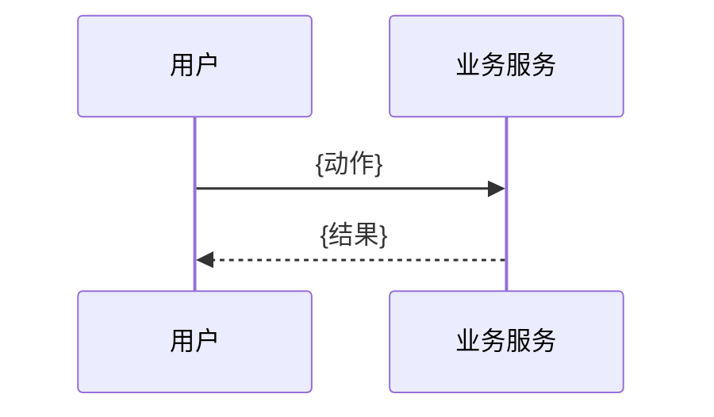

# {产品名称} PRD {版本号}

> **产品名称**：{产品名称}　**所属平台**：{小程序/H5/App/后台系统/API服务}
> **版本**：{版本号}　**文档版本**：v{文档版本号}　**最后更新**：{日期}
> **产品经理**：{PM}　**状态**：{草稿/需求评审中/开发中/已上线}

**修订说明**

<!-- AI_INSTRUCTION: 首版写“初稿”；评审后每轮追加一行，写“改了什么、为什么”。评审修订模式见 references/revision.md -->

| 轮次 | 日期 | 主要变更 | 修改人 |
|---|---|---|---|
| 初稿 | {日期} | 首次成稿 | {PM} |

---

## 1. 项目背景

<!-- AI_INSTRUCTION: 必填。写清“为什么现在做”，不要写成产品介绍。 -->

### 1.1 背景描述

{2-3 段：业务痛点、机会、触发这次需求的事件}

### 1.2 目标用户

| 维度 | 描述 |
|---|---|
| 用户群体 | {群体描述} |
| 典型场景 | {使用场景} |
| 核心诉求 | {核心诉求} |

### 1.3 核心目标

<!-- AI_INSTRUCTION: 至少 1 个可量化指标（数字/百分比），并写明如何统计。 -->

| 目标维度 | 关键指标 | 目标值 |
|---|---|---|
| {维度} | {指标} | {目标值} |

**北极星指标**：{指标及目标值}

---

## 2. 产品概述与业务模式

### 2.1 产品定位

{50-100 字：是什么、为谁、解决什么、怎么解决}

### 2.2 核心业务流程

<!-- AI_INSTRUCTION: 必须同时有 sequenceDiagram（跨角色调用链）和 flowchart（端到端业务流程）。这里是“业务”视角，页面视角的流程图在 3.x。 -->



```mermaid
flowchart TD
    A[{起点}] --> B{判断}
    B -->|条件1| C[处理]
    B -->|条件2| D[处理]
```

### 2.3 功能架构

| 一级模块 | 优先级 | 子模块 / 功能点 | 说明 |
|---|:-:|---|---|
| {模块} | P0 | {子模块} → {功能点} | {说明} |

---

## 3. 产品功能说明

### 3.0 阅读指引与整体页面流程图

<!-- AI_INSTRUCTION: 写 2-4 句“怎么读这份文档”：先看下图了解全貌，再按章节顺序阅读；每章开头有本章流程图和页面清单。整体图只含主干页面，细节在各章。图由 prdkit flow 生成，不手工画、不用 Mermaid。 -->

按用户使用顺序组织：{一句话说明章节顺序，例如“先找到想借的东西 → 申请借用 → 归还评价”}。每章开头先看本章流程图和页面清单，再看逐页说明。


---

### 3.1 {章名：用户在这一章完成什么}

<!-- AI_INSTRUCTION: 章号、章名、顺序必须与 spec/screens.json 的 chapters 一致（lint L-320/L-420）。章名用“用户视角的任务”，不用“XX模块”。 -->

**本章页面关系总览**：{2-3 句：用户从哪来，在本章做什么，最终去哪；点出 1-2 个关键分支}


**本章页面清单**：

<!-- AI_INSTRUCTION: 本表由 `prdkit.py flow --table` 生成后粘贴，不手写；页面登记变了就重新生成。本章页面+弹窗≥3 个时，流程图与清单都必须有（lint L-321~L-324）。 -->

| 页面/弹窗 | 章节 | 类型 | 进入方式 | 去向 |
|---|---|---|---|---|
| {页面} | 3.1.3.1 | 页面 | {来源页：动作} | {动作→目标页} |

#### 3.1.1 功能描述

**As a** {角色}，**I want** {能力}，**So that** {价值}。

**范围**：{本章包含什么、明确不包含什么}

#### 3.1.2 业务规则

| 编号 | 规则描述 | 边界条件 / 说明 |
|---|---|---|
| BR-{XX} | {可执行、无歧义的规则} | {边界、例外、取值范围} |

#### 3.1.3 页面交互说明

<!-- AI_INSTRUCTION: 每个页面/状态/弹窗一个 ##### 小节，编号对应 spec 的 section。截图只能来自 shot 命令，不得画线框/ASCII。小节标题必须是“页面交互说明 — {页面名}”，首行必须是“**流转**：…”。不要手写“**关联原型**”行：Demo 发布前不写原型地址，发布后由 `prdkit.py links --apply` 统一生成。 -->

##### 3.1.3.1 页面交互说明 — {页面名}

**流转**：{来源页} 点“{动作}” → **本页** → 点“{动作}”到 {目标页}；{异常/边界去向}


| 元素 | 类型 | 说明 |
|---|---|---|
| {元素} | 按钮/输入框/卡片/列表 | {做什么；什么条件下显示/置灰} |

**交互规则**：

1. {点击 X → 结果（含失败分支）}
2. {状态切换、加载、空态}

#### 3.1.4 数据字段说明

| 字段 | 类型 | 必填 | 校验规则 | 说明 | 示例 |
|---|---|:-:|---|---|---|
| {字段} | String | 是 | {规则} | {说明} | {示例} |

#### 3.1.5 异常处理

| 异常场景 | 处理策略 | 用户提示文案 |
|---|---|---|
| 网络异常 | {重试/缓存} | “{文案}” |
| 数据为空 | {空态} | “{文案}” |

#### 3.1.6 埋点需求

| 事件 ID | 事件名 | 触发时机 | 关键参数 |
|---|---|---|---|
| EVT-{XX} | {page_view} | 进入{页面} | page_name |

<!-- AI_INSTRUCTION: 选填子章节（按需追加到 3.x.7 起）：状态流转（stateDiagram）、接口依赖、竞品参考。 -->

---

## 4. 非功能需求

### 4.1 性能要求

| 指标 | 要求 |
|---|---|
| 首屏加载 | ≤{N} 秒 |

### 4.2 兼容性要求

| 平台/环境 | 最低版本 |
|---|---|
| {平台} | {版本} |

### 4.3 安全与隐私

- {要求}

---

## 5. 上线策略

<!-- AI_INSTRUCTION: 选填。若省略本章，后面的“附录”章号顺延为 5（lint L-206 检查章号连续）。 -->

{灰度范围、节奏、关注指标、回滚条件}

---

## 6. 附录

### 附录A：术语表

| 术语 | 说明 |
|---|---|
| {术语} | {解释} |

### 附录B：可交互 Demo 页面

<!-- AI_INSTRUCTION: 本节整体由 `prdkit.py links --apply` 按 spec 生成，不手写。Demo 尚未发布时只写“在线 Demo 发布后，此处将补充各页面的预览链接”；发布后写各页面在线链接和访问权限；用户明确不发布时写本地文件并说明“本版未发布在线 Demo”。运行后本节占位内容会被整体替换，lint L-510~L-515 会检查是否与 Demo 状态一致。 -->

| Demo 页面 | 对应 PRD 章节 | 本地文件 |
|---|---|---|
| {页面名} | 3.x.3.x | `prototype/pages/{文件}.html` |

### 附录C：默认取值与待补充

<!-- AI_INSTRUCTION: 选填，有内容才保留本节，否则整节删除。“默认取值”= 需求理解（第 1 步）里你预设、用户已确认的业务取值，方便评审追溯和调整；“待补充”= 真无法预设、也没拿到的取值，正文对应位置标 `[待确认-需PM补充]`。交付时只告诉用户待补充的条数，不逐条念。 -->

**默认取值**（已与产品确认，可调整）

| 取值 | 默认值 | 所在规则 |
|---|---|---|
| {例：输入字数上限} | {例：200 字} | BR-{XX} |

**待补充**（需要业务数据才能确定，不影响评审）

| 事项 | 影响范围 | 建议由谁补充 |
|---|---|---|
| {例：试点周期} | {例：上线策略} | {例：业务负责人} |
